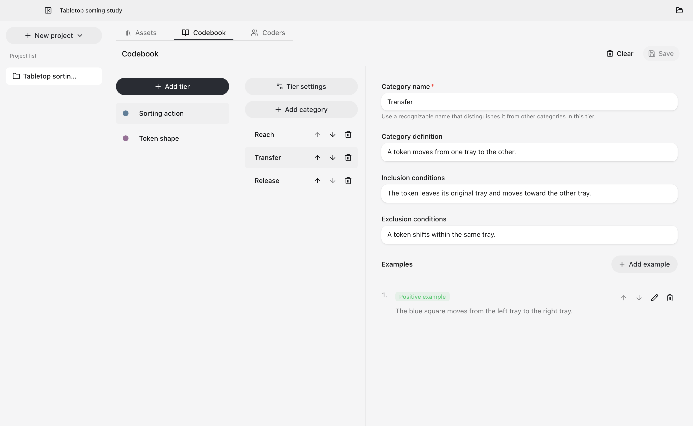
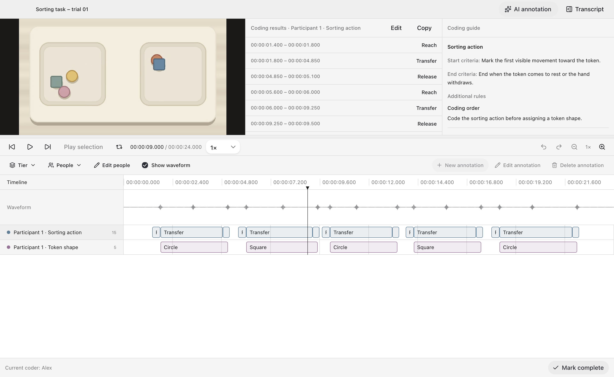
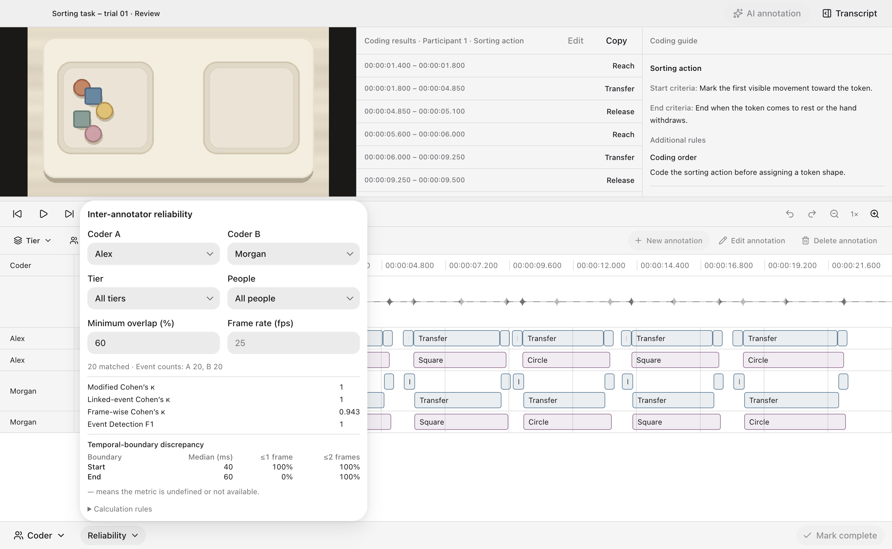

# Panorama Codebook


A desktop workspace for coding audio and video in qualitative research, by Panorama Lab. Define a coding protocol, annotate recordings on a timeline, and compare coder agreement within a local project.

English · [简体中文](README_zh-CN.md)

[Glossary](GLOSSARY.md)

[Website](https://panorama-lab.com/codebook) · [Download](https://github.com/panorama-lab/codebook/releases) · [Report an issue](https://github.com/panorama-lab/codebook/issues)

## What you can do

- **Define a coding protocol.** Create color-coded tiers and categories. Document when an event starts and ends, which cases to include or exclude, and examples coders can consult in the coding guide.
- **Annotate recordings in context.** Create and adjust intervals with the media player, waveform, timeline, and coding guide in the same window. Loop a selection, change playback speed, and undo or redo edits.
- **Review coder agreement.** Track each coder’s progress and keep their records separate. Compare two coders by tier and person using event detection F1, Cohen’s κ, and differences in annotation boundaries.
- **Work with transcripts.** Import SRT subtitles or generate a transcript with MiniMax. Click transcript text to seek through the recording, edit the transcript, and link source speaker labels to people in the project.
- **Review AI annotation suggestions.** Connect a configured Codex or WorkBuddy installation, choose a person, tier, and time range, and review the generated annotations before importing them.
- **Keep projects locally.** Code offline and use a `.codebook` archive to back up or move a project with its media, transcript, and annotations.
- **Choose your interface language.** Use English, Simplified Chinese, or the system language. Changing the interface language leaves research content unchanged.

## Screenshots

The same sample project is shown in the protocol editor, coding workspace, and reliability report.







## Download

- **Windows:** Download from the [Microsoft Store](https://apps.microsoft.com/detail/9mtljg2dnbm2).
- **macOS on Apple Silicon (arm64):** Download from [GitHub Releases](https://github.com/panorama-lab/codebook/releases).

Packaged macOS releases check for updates on startup. You can also choose **Panorama Codebook → Check for Updates…**. Downloading an update requires confirmation, and installation can be postponed until you are ready to restart.

## Get started

1. **Create a project.** Choose **New project → Empty project** and enter a name. To open a `.codebook` archive, choose **New project → Import project**.
2. **Define your codebook.** In the **Codebook** tab, add tiers and categories, then enter timing criteria, rules, and examples. Click **Save** to apply your changes.
3. **Add coders and recordings.** Create local coder identities in **Coders** and add audio or video with **Import media** in **Assets**. Codebook copies imported recordings into the project.
4. **Annotate a recording.** Open an asset and choose a coder. Add a person if the recording has none. Drag on a tier to select an interval, then click **New annotation** or press Enter. Use the timeline or annotation list to revisit and edit saved intervals.
5. **Mark the recording complete.** Completion is tracked per coder. Further edits reopen the record. Codebook changes flag completed records for review.
6. **Compare two coders.** In **Coders**, choose **Review** for the recording, open **Reliability**, and select two saved coding records. Filter by tier or person as needed.

Each recording/coder pair opens in its own coding window, so you can keep several workspaces open alongside the project window.

## Automatic transcription

Open **Panorama Codebook → Settings… → Transcribe**, choose **New provider**, and configure MiniMax with your API key and the `asr-1.0` model. In a recording’s coding window, open the transcript sidebar and choose automatic transcription.

Audio is sent to MiniMax in chunks. Provider usage may incur charges; retrying starts a new run. Failed or canceled transcription leaves the existing transcript intact. Replacing a transcript requires confirmation and archives the previous version in the project.

Transcripts are shared across coders for the same recording. Choose **Import → SRT** in the transcript panel to preview and import a subtitle file. You can edit the saved text and map source speaker labels to people in the project.

## Project files and backups

Codebook manages project folders locally. Use **Export project** to create a `.codebook` archive, and **Import project** to restore it on another computer. Each project folder contains JSON records and imported media.

```text
project.json                 Project identity and format version
codebook.json                Coding protocol, tiers, and categories
coders.json                  Local coder identities
assets/                      Recording metadata
media/                       Imported recordings and extracted audio
coding/                      Annotations organized by recording and coder
speakers/                    People associated with recordings
transcripts/                 Transcripts and archived versions
ai-sessions/                 AI annotation sessions and generated results
```

Saved JSON records use atomic replacement and retain the previous version in an adjacent `.bak` file. Back up the entire project folder to preserve both recordings and annotations. Close the project before moving or restoring it; media paths are relative to the project folder.

Multiple app instances or cloud-synced folders must not edit the same project concurrently. Multiple local coder identities provide separate annotation records, rather than live collaboration.

## Feedback

Use [GitHub Issues](https://github.com/panorama-lab/codebook/issues) for bug reports and feature requests. For playback or annotation problems, include your app version, operating system, media format, and steps to reproduce. Remove API keys and private research material before sharing files.

## Usage

Panorama Codebook is currently free for educational use and research purposes.
