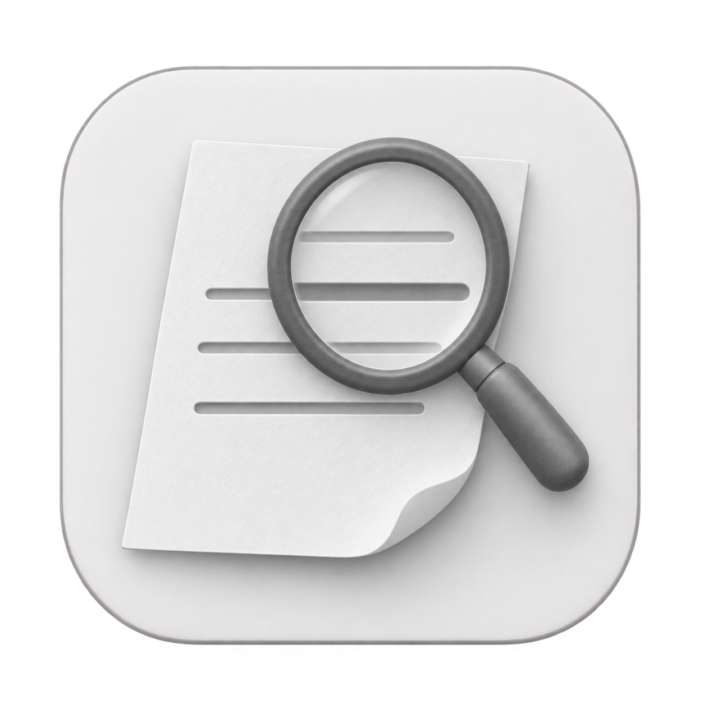
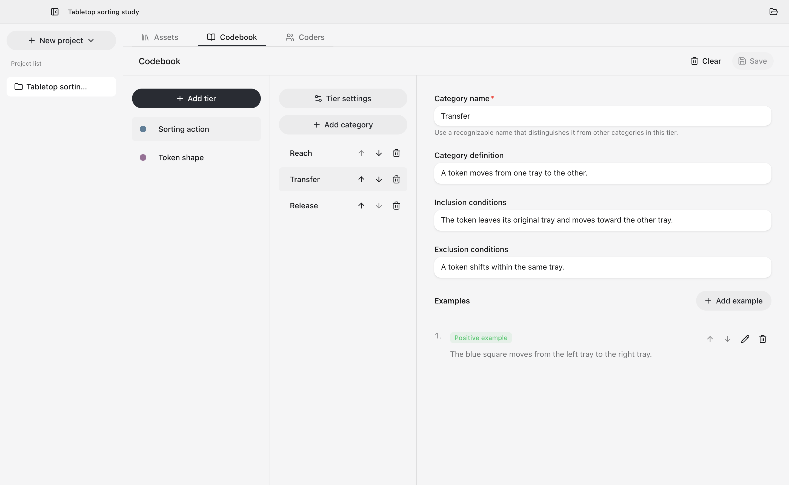
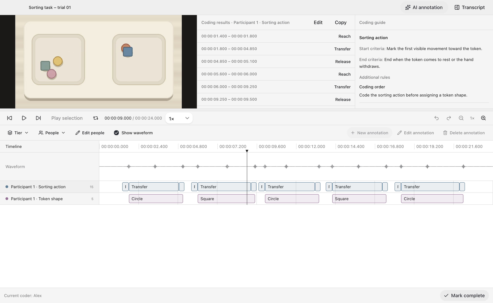
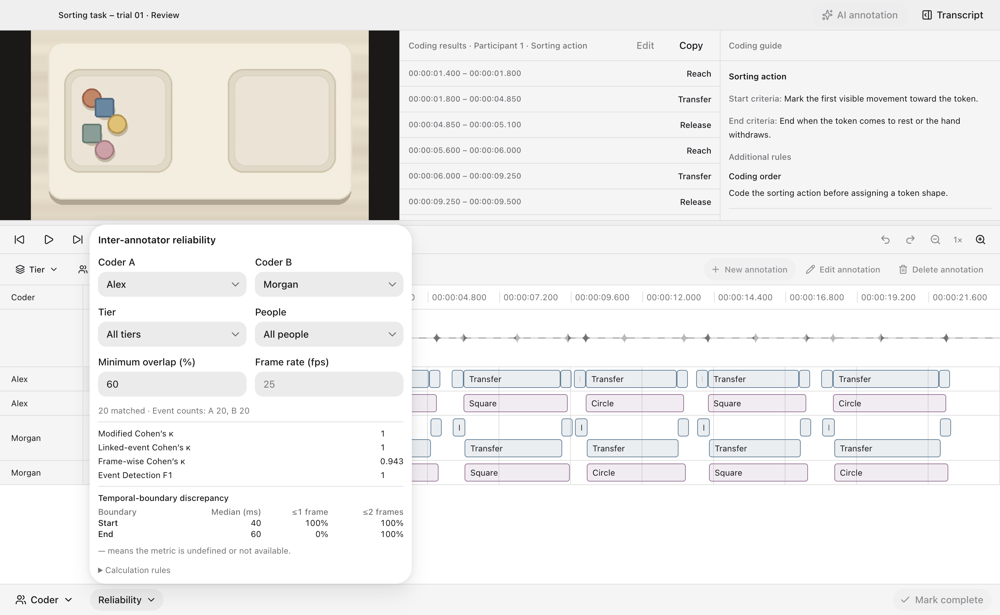

# Panorama Codebook



Panorama Lab 开发的音视频质性研究编码桌面工具。制定编码手册，在时间轴上标注录音与视频，并在本地项目中比较编码员的一致性。

[English](README.md) · 简体中文

[术语表](GLOSSARY_zh-CN.md)

[官方网站](https://panorama-lab.com/codebook) · [下载应用](https://github.com/panorama-lab/codebook/releases) · [问题反馈](https://github.com/panorama-lab/codebook/issues)

## 主要功能

- **制定编码方案。** 创建以颜色区分的标注层和类别，记录事件起止标准、纳入与排除条件以及示例。编码员可在标注时查阅编码指南。
- **结合原始材料进行标注。** 在同一工作区查看播放器、波形、分层时间轴和编码指南，创建并调整标注区间。支持循环播放选区、变速播放、撤销与重做。
- **复核编码一致性。** 分别保存每位编码员的标注和完成状态。可按标注层和人物比较两位编码员的事件检测 F1、Cohen’s κ 和标注边界差异。
- **使用转写文本。** 导入 SRT 字幕或通过 MiniMax 生成转写。点击转写文本可定位到对应片段，也可以编辑文本，将来源说话人标签关联到项目中的人物。
- **复核 AI 标注建议。** 连接已配置的 Codex 或 WorkBuddy，选择人物、标注层和时间范围，检查生成结果后再导入标注。
- **本地保存项目。** 手动编码支持离线使用。导出 `.codebook` 归档，即可备份项目，或将媒体、转写和标注一起迁移到另一台电脑。
- **切换界面语言。** 支持英文、简体中文或跟随系统。切换界面语言不会修改研究材料的原始内容。

## 应用截图

以下截图展示了同一示例项目的编码手册编辑器、编码工作区和一致性报告。







## 下载

- **Windows：** 前往 [Microsoft Store](https://apps.microsoft.com/detail/9mtljg2dnbm2) 下载。
- **Apple Silicon（arm64）Mac：** 前往 [GitHub Releases](https://github.com/panorama-lab/codebook/releases) 下载。

打包发布的 macOS 应用会在启动时检查更新，也可通过 **Panorama Codebook → 检查更新…** 手动检查。更新下载需要确认，下载后可选择稍后重启安装。

## 快速开始

1. **创建项目。** 选择 **新建项目 → 空项目** 并输入名称。如需打开 `.codebook` 归档，选择 **新建项目 → 导入项目**。
2. **制定编码手册。** 在 **编码手册** 标签页添加标注层和类别，填写起止标准、规则和示例，然后点击 **保存**。
3. **添加编码员和材料。** 在 **编码员** 中创建本地编码员，在 **素材** 中选择 **导入素材** 添加录音或视频。应用会将文件复制到项目中。
4. **开始标注。** 打开素材并选择编码员。如果该素材还没有人物，请先添加。在标注层上拖动选定时间区间，然后点击 **新建标注** 或按 Enter。可从时间轴或标注列表回看和修改已保存的标注。
5. **标记完成。** 每位编码员的完成状态单独记录。继续编辑会重新打开该记录，编码手册更新会将已完成的记录标记为需要复核。
6. **比较两位编码员。** 在 **编码员** 标签页点击素材旁的 **复核**，打开 **一致性** 并选择两条已保存的编码记录。可按标注层或人物筛选。

每个“材料与编码员”组合都有独立的编码窗口，可以与项目窗口一起打开，同时查看多个工作区。

## 自动转写

打开 **Panorama Codebook → 设置… → 转写**，选择新增服务商，配置 MiniMax API 密钥和 `asr-1.0` 模型。在材料的编码窗口中打开转写文本侧栏，选择自动转写。

音频会分块发送至 MiniMax，服务商可能收取使用费用；重试会启动新的转写任务。失败或取消不会覆盖已有转写。替换已有转写需要确认，旧版本会归档到项目文件夹中。

同一材料的转写文本由所有编码员共享。在转写面板选择 **导入 → SRT**，可预览并导入字幕。保存后可以编辑文本，也可以将来源说话人标签关联到项目中的人物。

## 项目文件与备份

应用在本地管理项目文件夹。通过 **导出项目** 生成 `.codebook` 归档，再通过 **导入项目** 在另一台电脑上恢复。项目文件夹内包含 JSON 记录和导入媒体。

```text
project.json                 项目标识与格式版本
codebook.json                编码方案、标注层与类别
coders.json                  本地编码员身份
assets/                      媒体元数据
media/                       导入的录音、视频与提取的音轨
coding/                      按材料与编码员组织的标注
speakers/                    与素材关联的人物
transcripts/                 转写文本与归档版本
ai-sessions/                 AI 标注会话和生成结果
```

JSON 记录通过原子替换保存，并在相邻的 `.bak` 文件中保留上一版本。请备份整个项目文件夹，以同时保留原始材料和标注。移动或恢复项目之前，请先关闭项目；媒体路径相对于项目文件夹保存。

不要通过多个应用实例或云同步文件夹同时编辑同一个项目。多个本地编码员身份用于分别记录标注，不代表支持实时协作。

## 反馈

欢迎通过 [GitHub Issues](https://github.com/panorama-lab/codebook/issues) 提交问题和功能建议。反馈播放或标注问题时，请提供应用版本、操作系统、媒体格式和复现步骤。分享文件前，请移除 API 密钥和私密研究材料。

## 使用说明

Panorama Codebook 目前可免费用于教育和研究用途。
